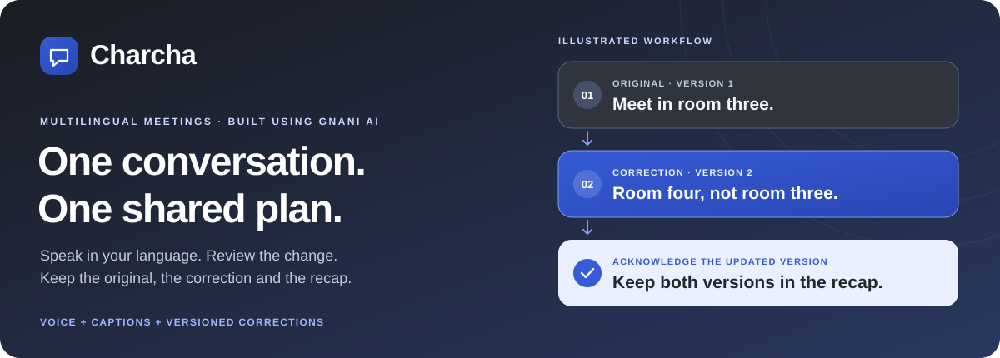
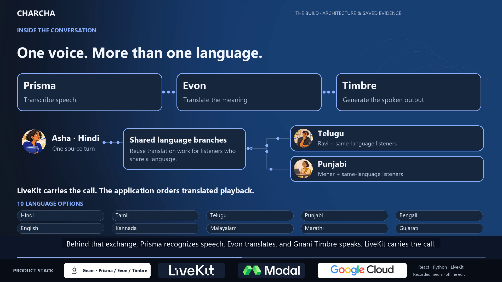
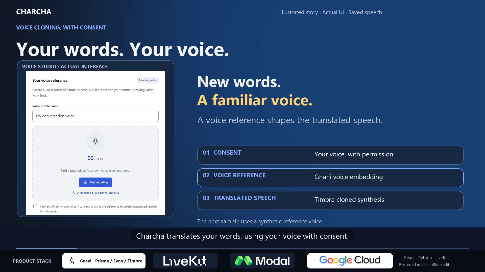
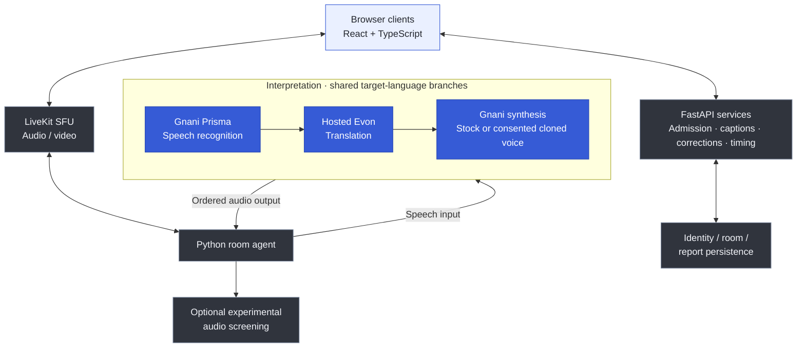

# Charcha · चर्चा

**Multilingual meetings with a reviewable record of what changed.**

Speak, read both languages, correct a message and acknowledge the updated version. Charcha brings spoken interpretation, original/translated captions and a bilingual recap into one audio/video meeting. An independent project built using Gnani AI.

| Watch the build | Hear the voice demo |
| :--- | :--- |
| [](docs/media/Charcha-2m40-multilingual-build.mp4) | [](docs/media/Charcha-60s-voice-cloning-social.mp4) |
| **[▶ 2:40 build film](docs/media/Charcha-2m40-multilingual-build.mp4)** | **[▶ 60-second social film](docs/media/Charcha-60s-voice-cloning-social.mp4)** |
| Voice samples, product workflow, architecture and dated evidence | Saved synthetic Hindi reference → English clone, plus Telugu/Punjabi stock voices |

**[Read the one-page pitch ↗](docs/Charcha-one-page-pitch.pdf)** · **[Open the app ↗](https://charcha-234398803946.asia-south2.run.app/)** · [Reviewer access](docs/REVIEWER_GUIDE.md) · [Run locally](#run-locally-without-provider-credits) · [Submission guide](docs/SUBMISSION.md) · [Latest LinkedIn post](https://lnkd.in/p/g5rqTQaZ)

> **For reviewers:** Sign in at the [Reviewer workspace](https://charcha-234398803946.asia-south2.run.app/#/reviewer). Verified `@gnani.ai` accounts qualify for automatic reviewer access; other verified accounts can request administrator approval. Existing private invitations remain supported. Reviewer access permits hosting your own meetings, never administration. The [setup guide](docs/REVIEWER_GUIDE.md) explains shared or personal resources, pre-meeting preparation and account-scoped reports. Access alone does not start compute or establish a successful live provider flow.

[The workflow](#one-small-correction-three-important-steps) · [Features](#inside-the-application) · [Architecture](#how-it-fits-together) · [Evidence](#what-has-been-checked) · [Project record](#checks-and-project-record)

## One small correction. Three important steps.

A workshop organiser says, **“Bring twelve blue files to room three at four.”** Then the room changes to four. Each participant needs the updated instruction and a visible way to acknowledge it.

| 01 · Hear and read | 02 · Review the change | 03 · Keep the shared plan |
| :--- | :--- | :--- |
| Listen to an interpretation and see original/translated captions. | Preserve the original and create a new version of the corrected message. | Acknowledge the new version individually; retain both versions in the bilingual recap. |

For teams, students and community organisers coordinating changed times, quantities or locations. The build film follows fictional Asha, Ravi and Meher through Hindi, Telugu and Punjabi, using actual interface screens from a scripted three-account rehearsal and prepared speech readings.

## Inside the application

| Capability | What is implemented |
| :--- | :--- |
| **Speak across languages** | LiveKit browser audio/video with Hindi, Tamil, Bengali, English, Telugu, Kannada, Malayalam, Marathi, Gujarati and Punjabi options. Prisma recognition → hosted Evon translation → Gnani speech synthesis and consented own-voice cloning. Live interpretation needs configured credentials and available compute. |
| **Review each version** | Original/translated captions, number and selected-negation highlighting, versioned corrections and acknowledgements per eligible listener. An acknowledgement records understanding; it does not establish contractual agreement or verify accuracy. |
| **Take the recap with you** | PDF printing, WhatsApp preview/copy, text and JSON export. Sharing is user-initiated. The SHA-256 fingerprint identifies the recorded payload; it is not a signature or immutable ledger. |
| **Control the meeting** | Host sign-in and admission, separate administrator authenticator verification, device controls and refresh/reconnect recovery for an admitted seat. |
| **Inspect performance** | Queue and stage measurements, browser observations and account-scoped saved performance reports. Missing measurements remain explicit. |
| **Share language work** | Shared translation/synthesis per target language, ordered playback and bounded preparation concurrency. Modal compute follows occupied interpreted meetings and scales down afterward; startup and idle time still consume compute. |
| **Explore VoiceShield** | Optional experimental source-audio screening, visible results and a local Audio lab. Model scores are separate from DSP diagnostics and do not establish identity or validated fraud prevention. |

## How it fits together



Pages, hooks, services and media adapters are separated under `web/src/`. Provider adapters, routing, screening, membership and persistence live under `server/charcha/`. Tests are in `web/src/`, `server/tests/` and `evaluation/`. [Read the architecture →](docs/ARCHITECTURE.md)

The app/media/identity deployment uses GCP Delhi; Evon uses the configured Modal allocation. The full processing chain is not verified India-only. LiveKit is an SFU, not a peer-to-peer mesh. Active rooms and embeddings are memory-resident: use one API worker and consult the [operating guide](docs/ON_DEMAND_MEETINGS.md). Server performance history and browser-saved recaps have distinct persistence scopes.

## What has been checked

**Dated results, with their measurement boundaries.** Application tests, deployment checks and provider measurements answer different questions.

| Evidence | Result | Measurement boundary |
| --- | --- | --- |
| Reviewer access release, 11 Nov 2026 | **1,614 backend tests passed, one skipped; 342 frontend tests; seven runtime checks; build passed** | Local desktop/mobile checks covered automatic domain access, admin approval, denial and revocation. Hosted health/access checks passed; all 43 backend source hashes matched. No live provider flow or Gnani/Modal calls. [Verification record](docs/REVIEWER_DOMAIN_ACCESS_VERIFICATION.json) |
| Reviewer reporting release checks, 10 Nov 2026 | **1,579 backend tests passed, one skipped; 335 frontend tests across 47 files; seven runtime checks; build passed** | Local checks with provider responses mocked. Eight focused reporting tests also passed, overlapping the full suite; counts are not additive. Desktop/mobile scoped-report walkthrough passed against the local API without provider calls |
| Hosted reporting release checks, 10 Nov 2026 | Health 200; reviewer/prejoin/usage/performance components present; protected anonymous requests denied; all 43 deployed source hashes matched with no missing/extra files | Health/access checked at 16:31:03 UTC; full source match at 16:31:12 UTC. No authenticated live provider flow or provider calls |
| Local checks, 9 Nov 2026 | 1,468 backend tests passed, one skipped; 322 frontend tests and seven runtime checks passed; build passed | Isolated application checks, not a new provider-quality test |
| Two demo cases, 9 Nov 2026 | **3.94 s** original turn; **4.23 s** typed correction | Translation start → first decoded synthesis audio; excludes STT, meeting transport and listener playback |
| Five-language stage, 31 Oct 2026 | Nine of ten attempted routes delivered across Hindi, Tamil, Bengali, Telugu and Marathi | One failed during local setup before provider use; delivery is not a meaning-accuracy score |
| Media-token recovery | Same admitted seat reconnects after injected token expiry in isolated local Chrome | Original-audio transport; microphone/camera remain off after reload |

<details>
<summary><strong>What the films demonstrate — and the limits of the evidence</strong></summary>

The films use fictional illustrations, actual interface screens from a scripted three-account rehearsal and prepared speech, with original locally synthesized background music. Both films include a saved **synthetic Hindi reference → English cloned-voice sample**, alongside Telugu and Punjabi stock-voice readings. This is an edited sample comparison, not evidence of cloning a real participant's voice or a new live three-device interpretation test. The build film also explains the architecture and separately dated provider measurements above. This film refresh reuses saved audio and makes no new provider calls.

Ten configurable languages do not imply tested quality for every pair. VoiceShield has no established detection-accuracy figure. See [evaluation](docs/EVALUATION.md), [route evidence](web/src/data/fiveLanguageStageResults.json) and [submission evidence](docs/SUBMISSION.md).

</details>

**Portal update · 14 November 2026:** Sathvika's approved Telugu-speaker feedback is now visible before sign-in and on Overview, with her latency observation retained. Mobile feedback cards and live-meeting guidance were checked locally and deployed. All 342 frontend tests passed; hosted health and access checks passed without provider calls. [Verification record →](docs/PARTICIPANT_FEEDBACK_VERIFICATION.json)

**Reviewer release · 11 November 2026:** `reviewer-domain-access-20261111` remains the API release. Verified `@gnani.ai` accounts receive reviewer access automatically; other verified accounts request administrator approval. Existing invitations, personal provider choices and pre-meeting preparation remain available. The films, pitch and their dated evidence are unchanged. [Full release record →](docs/SUBMISSION_RELEASE_NOTES.md)

## Run locally without provider credits

Requirements: Node.js 22+, Python 3.11+, [uv](https://docs.astral.sh/uv/getting-started/installation/) and Windows PowerShell for these scripts.

```powershell
git clone https://github.com/Jatin2567/Charcha.git
cd Charcha
.\scripts\setup.ps1
.\scripts\setup-livekit.ps1
npm run check:conference
npm run dev:local
```

Open `http://127.0.0.1:5180/#/tests`. This starts **original-audio transport**, with provider interpretation, cloning and screening disabled. Use separate browser profiles and headphones. Setup downloads dependencies and pinned LiveKit; it does not call speech/GPU providers.

Keep live settings in private `server/.env`; consult `server/.env.example` and deployment guides. A Gnani speech key alone does not provision Evon compute. Microphones require localhost or trusted HTTPS.

## Checks and project record

```powershell
npm run test:conference-runtime
npm run test:web
npm run test:server
npm run build
```

Tests use fixtures and isolated services. Keep date, scope and command alongside results; test counts do not establish human translation quality.

| Build and operate | Evaluate and review | Follow the project |
| :--- | :--- | :--- |
| [Architecture](docs/ARCHITECTURE.md) | [Evaluation](docs/EVALUATION.md) | [Submission guide](docs/SUBMISSION.md) |
| [Operating guide](docs/ON_DEMAND_MEETINGS.md) | [Reviewer setup](docs/REVIEWER_GUIDE.md) | [Publication record](docs/SUBMISSION_RELEASE_NOTES.md) |
| [Source and commit history](https://github.com/Jatin2567/Charcha/commits/main/) | [Award evidence map](docs/AWARD_POSITIONING.md) | [Final submission review](docs/FINAL_SUBMISSION_CHECK.md) |

Charcha is not an official Gnani, Google or Modal product. Development and demo production used AI assistance and established libraries. Awards and internships depend on Gnani's review and [programme rules](https://www.gnani.ai/internship).
