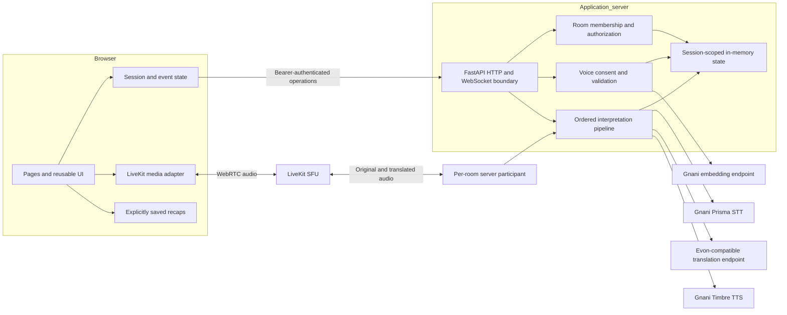
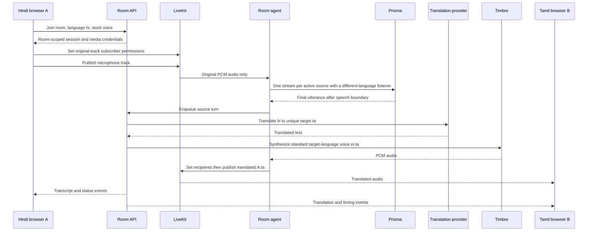
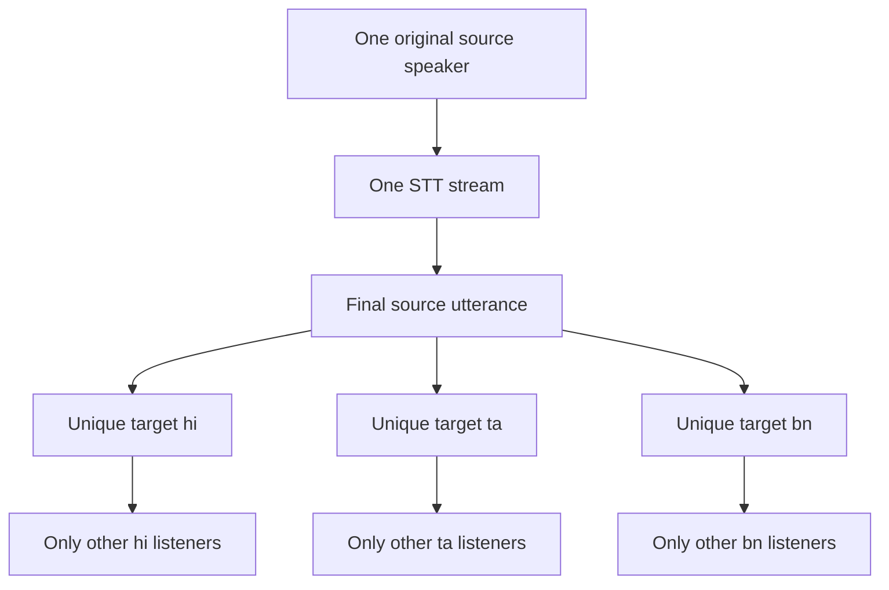

# Artha-Mesh architecture

## Local screening and receiver measurements

`ScreeningRuntime` owns one checksum-validated CPU model session, with at most two inference operations. Native work runs outside the RTC event loop; repeated cancellation retains its concurrency slot until the thread ends. `ScreeningGate` owns a bounded complete-window buffer and one queued window per microphone. Monitor forwards immediately and records experimental verdicts. Enforcement releases only assessed low-score complete windows, withholds unknown/failed/overloaded windows, cancels translation and flushes output before and after cancellation. Original, resampled and synthesized capture paths recheck screening permission. Test-tone probes bypass microphone screening because they are explicitly generated by the server for one listener.

`audio_lab.py` is a separate opt-in loopback router for consented bounded in-memory WAV analysis. DSP proxies are diagnostics only; the uncalibrated AASIST score is not human identity, liveness or reliable deepfake evidence. The model is MIT/NAVER-origin and not Indian-trained. No provider access or automatic downloads occur in screening.

`ListenerMetrics` issues expiring single-use challenges bound to a room and participant. The server restricts each dedicated probe track to that listener. Browser `ProbeSignalTracker` measures request-to-decoded-track energy on a single monotonic clock with two observations, then submits an authenticated report. Delivery errors, cancellation, timeout and expiry remain outside successful percentiles. The browser measurement is client-reported, excludes physical playback and translation, and never changes the existing server-first-PCM boundary. Shared-recording manual annotations provide a separate explicitly human-reviewed path for actual listener timing.

Artha-Mesh is a browser-based Indic conversation interpreter with ten configurable languages: Hindi, Tamil, Bengali, English, Telugu, Kannada, Malayalam, Marathi, Gujarati and Punjabi. A four-language scripted demonstration, provider-free original-audio transport and the credential-dependent live pipeline are explicit modes. The ten-language registry and mocked routing are implemented; real meaning/listening acceptance is tracked separately for each of the ninety directed pairs. See [the language flow](LANGUAGE_TEST_MATRIX.md) for fan-out, stock voices and staged testing.

## Product pages and responsibilities

| Page           | User task                                                    | Owns                                                                                 | Must delegate                                                   |
| -------------- | ------------------------------------------------------------ | ------------------------------------------------------------------------------------ | --------------------------------------------------------------- |
| Home           | Create or join a conversation; try the demonstration         | Invitation entry, room title and mode explanation                                    | Room creation and invitation validation to the API              |
| Prejoin        | Choose name, spoken/listening language, microphone and voice | Device preview, permissions, stock/cloned voice choice and explicit consent          | Membership credentials and voice authorization to the API       |
| Meeting        | Speak, listen, read translations and confirm understanding   | Speaker cards, connection state, audio controls, transcript and confirmation actions | Audio routing to LiveKit/agent; translation to server services  |
| Recap/history  | Review, export, explicitly save or delete a local recap      | Local saved recap lifecycle; clear provenance                                        | Protected live transcript retrieval to the API                  |
| Voice studio   | Enroll or delete a consented voice reference                 | Recorded/uploaded reference, consent, validation feedback                            | Media validation and embedding generation/storage to the server |
| Setup/settings | Understand readiness and configure the application           | Health status, language/device preferences and setup instructions                    | All secret credentials to server environment variables          |

No microphone permission is needed on the home page. A page does not directly call an AI provider or decide who may subscribe to audio. Shared components own presentation; hooks/adapters own browser media and events; service clients own transport; server services own business rules. `docs/CONTRACT.md` defines the shared HTTP and event schema.

## Code map

| Location                                 | Responsibility                                                             |
| ---------------------------------------- | -------------------------------------------------------------------------- |
| `web/src/pages/`                         | Home, prejoin, meeting, recap, voice studio and settings page composition  |
| `web/src/components/`                    | Shared shell, buttons, speaker cards, transcript and enrollment views      |
| `web/src/hooks/useDevices.ts`            | Device permissions, enumeration and preview lifecycle                      |
| `web/src/hooks/useMeetingAudio.ts`       | Meeting audio lifecycle and user controls                                  |
| `web/src/hooks/useRoomEvents.ts`         | Event subscription and reconnect state                                     |
| `web/src/hooks/useVoiceRecorder.ts`      | Consented reference recording lifecycle                                    |
| `web/src/services/api.ts`                | Typed HTTP API and errors                                                  |
| `web/src/services/livekit.ts`            | Browser media SDK, audio attachment and track filtering                    |
| `web/src/services/demo.ts`               | Explicitly labelled offline scripted behavior                              |
| `web/src/state/`                         | Application preferences/session storage and room event reducer             |
| `web/src/types/domain.ts`                | Browser contract types                                                     |
| `server/artha_mesh/main.py`              | API transport, validation dependencies, lifecycle and response headers     |
| `server/artha_mesh/services/rooms.py`    | Membership, consent, participant changes and demo orchestration            |
| `server/artha_mesh/services/pipeline.py` | Per-source ordered queues, target fanout and metrics                       |
| `server/artha_mesh/services/routing.py`  | Language/recipient policy independent of UI/media SDK                      |
| `server/artha_mesh/services/voice.py`    | Reference validation and profile ownership                                 |
| `server/artha_mesh/providers/`           | Gnani, Evon-compatible endpoint and dictionary adapters                    |
| `server/artha_mesh/transport/`           | Media tokens, per-room agent, original streams and PCM output              |
| `server/artha_mesh/store.py`             | Ephemeral rooms, hashed credentials, bounded consumers and retention       |
| `server/tests/`                          | Behavior, authorization, queue and mocked provider-contract tests          |
| `evaluation/`                            | Synthetic draft cases, actual-run collector and externally rated reporting |

## Boundaries

The application server exposes no API keys, embeddings or upstream raw errors to clients. A room invitation is a capability to request membership, not a user account. The membership bearer is scoped to its room and participant. Voice profiles are owned by that membership, cannot be attached by another member and remain session-scoped. This is a prototype identity model; use authenticated accounts, revocation and an admission policy before public multi-tenant hosting.

The current store is in-memory. Run one application worker: multiple independent workers do not share rooms, tokens, embeddings or WebSocket consumers. Restarting loses unsaved server state. A production extension needs a shared transactional store, event bus, TTL cleanup, quotas and admission controls. Do not turn an in-memory demo into a persistent store by logging sensitive payloads.

## Live interpretation sequence

The transcription boundary matters: a streaming transport is not simultaneous word-by-word interpretation. Speech segmentation and sentence completion contribute latency. Translation jobs for a source are ordered; unique target languages may execute concurrently. Output must retain source order for a given listener. Queues are bounded and provider operations time out; saturation is surfaced instead of silently accumulating unlimited work. Leaving a room must cancel/reject further work for that membership.

## Routing invariants

The routing matrix below uses A=Hindi, B=Tamil and C=Bengali. The diagonal never plays back to the source speaker.

| Source | Listener A (`hi`) | Listener B (`ta`) | Listener C (`bn`) |
| ------ | ----------------- | ----------------- | ----------------- |
| A      | No self audio     | `translated:A:ta` | `translated:A:bn` |
| B      | `translated:B:hi` | No self audio     | `translated:B:bn` |
| C      | `translated:C:hi` | `translated:C:ta` | No self audio     |

Two listeners with the same language share one language translation and synthesis. Same-language listeners receive the source speech through an agent-forwarded track; they do not require machine translation. Generated agent tracks never feed back into STT. Participant-specific LiveKit subscription permissions, not UI muting, enforce media routing. The raw microphone publisher grants the agent access. The agent grants only intended listeners access to its output.

**Trust boundary:** client-side publisher permissions protect normal application behavior, but a malicious modified client can publish differently. This prototype does not establish a hard server-side guarantee against a room member deliberately republishing audio. Do not claim cryptographic privacy or an untrusted-client isolation guarantee from frontend subscription filtering. LiveKit transports encrypted media; the interpretation agent and provider APIs necessarily process intelligible audio/text. This pipeline is not end-to-end encrypted against those processors.

## Demonstration and live behavior

| Capability    | Demonstration                                                 | Live mode                                                                  |
| ------------- | ------------------------------------------------------------- | -------------------------------------------------------------------------- |
| Conversation  | Known scripted dictionary and simulated participants          | Actual participant microphone audio via LiveKit                            |
| Translation   | Authored sample strings                                       | Configured model endpoint                                                  |
| Speech        | Optional browser device speech; voice/language support varies | Timbre PCM published by the room agent                                     |
| Voice profile | Explicitly marked demo profile; no generated clone            | Validated consented reference produces provider embedding                  |
| Timing        | Zero-valued, explicitly simulated metrics                     | Server pipeline timing; not receiver playback latency                      |
| Availability  | Works without provider keys                                   | Requires configured accounts, reachable endpoint and verified model access |

Unknown demo text is rejected rather than represented as translated. A failed live provider does not silently fall back to a scripted translation. Browser-only demonstration, where enabled, is labelled separately from server-connected and live states.

## Provider protocol decisions

Provider configuration is explicit and replaceable; branding on a homepage is not an executable API contract. These references were checked on 23 October 2026:

- [Gnani STT realtime](https://docs.gnani.ai/api/STT/stt-websocket): raw signed 16-bit mono PCM frames, with the actual sample rate and language declared in connection headers. Honor frame cadence and final speech boundaries. Do not send WAV headers into a PCM WebSocket.
- [Gnani-maintained LiveKit plugin](https://github.com/livekit/agents/blob/main/livekit-plugins/livekit-plugins-gnani/README.md): maintained STT/TTS integration and model configuration reference. Streaming uses 512-sample PCM chunks. Keep adapter versions compatible with the server SDK.
- [Voice-clone embeddings](https://docs.gnani.ai/api/VC/voice-clone-embeddings): 5–30 seconds of clean spoken reference, followed by reuse of the provider embedding. The response nests the embedding under `data.voice_clone_embedding`; it must never become a browser-visible identifier or client preference.
- [Gnani challenge guide](https://www.gnani.ai/resources/blogs/great-indian-ai-internship-challenge-2026): Evon v3.3 is open weights by request, rather than an assumed hosted challenge API. This application accepts an explicitly configured compatible inference endpoint; deploying the weights and obtaining access are separate operations.
- [LiveKit publication permissions](https://docs.livekit.io/transport/media/publish/): published tracks are subscribable by default. Explicit permissions are required before exposing originals or translations.

Adapter contract tests use local mocked HTTP/WebSocket responses. They establish request construction and defensive parsing, not current provider availability, account entitlement, cross-language clone quality, model latency or translation accuracy. Run a real credentialed smoke test before presenting live operation.

## Data lifecycle and deployment claims

Raw reference clips are validated and forwarded only for enrollment, then discarded by the application rather than written to persistent storage. An embedding is still a sensitive derived voice representation; in-memory storage is a retention choice, not anonymization. Provider-side retention must be confirmed separately. Room transcripts and membership credentials remain server memory; credentials are stored in browser `sessionStorage`. Recaps are retained locally only through explicit user save/export controls. A room participant can access that room's transcripts; translated audio routing is not transcript-level secrecy between members.

Membership validity is checked separately from whether a participant still appears in a room roster. Live audio source and recipient gates check active membership; expiry cleanup cancels source queues/readers, removes voice references and disconnects expired participants. The periodic bookkeeping sweep runs every 30 seconds and also runs when a room is created. A LiveKit join token's expiry alone is not treated as an active-media revocation mechanism.

Use HTTPS/WSS outside localhost; configure the exact permitted frontend origins and protect the reverse proxy. The browser sends its scoped membership credential in a WebSocket upgrade subprotocol header, not the URL. Treat that header as a bearer credential and redact it from diagnostics. Legacy query-token compatibility exists for older clients and tests; exclude those URLs from access logs.

Artha-Mesh demonstrates use of Indic models. It does **not** establish that every byte remains in India. Record each deployment location separately: LiveKit media/signaling, agent host, application store, Gnani processing, translation inference, diagnostics and backups. [LiveKit region pinning](https://docs.livekit.io/deploy/admin/regions/region-pinning/) restricts its network region separately from the agent host. Use an evidenced deployment inventory before making any sovereignty or residency claim.

## Release evidence

Automated tests cover membership isolation, invalid references/consent, routing, lifecycle and deterministic provider contracts. The evaluation tools separately collect actual live text-pipeline results and accept external bilingual ratings. They do not certify speech recognition, subjective voice similarity, or end-to-end audio latency. See [EVALUATION.md](EVALUATION.md) for the honest measurement boundary and remaining credentialed/browser checks.
